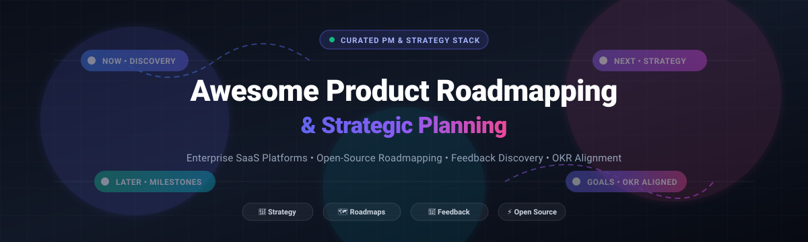

# Awesome Product Roadmapping & Strategic Planning 🚀

 
 

 

> 🎯 A curated, comprehensive list of top **Product Roadmapping**, **Strategic Planning**, and **Product Discovery** platforms — exploring both SaaS/Hosted commercial enterprise solutions and self-hosted open-source software for aligning strategy, customer feedback, and delivery execution.  
> ⭐ **Star this repository if you find it helpful!** ⭐

---

## 📈 Sector Overview & Market Dynamics

The global **product management and roadmapping software sector** is estimated between **$1.3B and $2.9B** (projected to reach **$4.5B–$8.0B+** by the early 2030s at an estimated **11%–12% CAGR**), propelled by remote collaboration, agile transformation, and product-led growth (PLG) strategies.

The market exhibits **moderate fragmentation with upper-tier concentration**: the top enterprise tier (commanded by Atlassian with Jira Product Discovery, Productboard, and Aha!) captures approximately 38%–43% of enterprise revenues, while the mid-to-lower tier remains highly fragmented among specialized discovery portals, OKR alignment platforms, and emerging open-source roadmapping tools rather than a single winner-take-all monopoly.

---

## 📋 Table of Contents

- [📈 Sector Overview & Market Dynamics](#-sector-overview--market-dynamics)
- [🟦 SaaS / Hosted Platforms](#-saas--hosted-platforms)
  - [Jira Product Discovery](#jira-product-discovery)
  - [Productboard](#productboard)
  - [Aha! Roadmaps](#aha-roadmaps)
  - [Dragonboat](#dragonboat)
  - [airfocus](#airfocus)
  - [ProductPlan](#productplan)
  - [Craft.io](#craftio)
  - [ProdPad](#prodpad)
- [🟩 Open-Source Software](#-open-source-software)
  - [Plane](#plane)
  - [Focalboard](#focalboard)
  - [OpenProject](#openproject)
  - [Planka](#planka)
  - [Leantime](#leantime)
  - [Vikunja](#vikunja)
  - [Fider](#fider)
  - [Taiga](#taiga)
  - [LogChimp](#logchimp)
  - [Roadmapper](#roadmapper)
  - [ClearFlask](#clearflask)
  - [Eververse](#eververse)
  - [Quackback](#quackback)
  - [ShipShipShip](#shipshipship)
  - [mouc](#mouc)
  - [product-roadmap-planner](#product-roadmap-planner)
- [📊 Comparison at a Glance](#-comparison-at-a-glance)
- [🔍 SEO Keywords & Topic Index](#-seo-keywords--topic-index)
- [🤝 Contributing](#-contributing)
- [💖 Support](#-support)
- [⭐ Star History](#-star-history)
- [📄 License](#-license)

---

## 🟦 SaaS / Hosted Platforms

Commercial, cloud-hosted Product Roadmapping and Strategic Planning platforms. Sorted by company size (valuation / estimated revenue, descending).

| Platform | Company Size (Valuation / Revenue) | Starting Paid Tier Price | Free Tier Limits | Key Highlights & Strategic Focus |
|:---|:---|:---|:---|:---|
| **[Jira Product Discovery](https://www.atlassian.com/software/jira/product-discovery)** | **~$45B+ Public Market Cap** (Atlassian ~$4.4B+ Revenue) | **$10.50/creator/month** (Standard plan; billed annually or $10.50/creator/mo monthly) | **Free Forever**: Capped at **3 creators**, unlimited free viewers/contributors, 2 GB file storage, and 100 automation executions/month | Built natively inside Atlassian; connects ideation, prioritization matrices, and roadmaps directly into Jira Software delivery workflows. |
| **[Productboard](https://www.productboard.com)** | **$1.7B Valuation** (~$70M–$75M ARR) | **$19/maker/month** (Plus plan, billed annually) or **$25/maker/month** (billed monthly) | **Free Forever**: Capped at **1 maker**, unlimited contributors, **500 total feedback notes**, 1 teamspace, 1 product portal, and 50 AI credits/month | Customer-feedback-driven discovery, feature prioritization scoring, and dynamic roadmap presentations across cross-functional teams. |
| **[Aha! Roadmaps](https://www.aha.io/roadmaps)** | **~$45M–$50M+ ARR** (Bootstrapped / Profitable) | **$59/user/month** (Premium tier, billed annually) | **30-Day Free Trial**: Full-featured access across all capabilities with unlimited users for 30 days; no permanent free editor tier | End-to-end strategy-to-delivery traceability, linking corporate strategic goals and initiatives to releases, features, and idea portals. |
| **[Dragonboat](https://dragonboat.io)** | **~$48M Valuation** (~$3.4M ARR; $15M Total Raised) | **$69/user/month** (Essential tier, billed annually; min contract typically $6,000/year) | **Guided Free Trial / Up to 100 Free Requestors**: Free read-only access for up to 100 stakeholders/requestors; core portfolio planning requires paid license | Multi-product portfolio alignment, strategic OKR allocation, resource capacity planning, and bi-directional Jira/Azure DevOps roadmapping. |
| **[airfocus](https://airfocus.com)** | **~$20M Total Funding** (~$5M ARR; Acquired by Lucid) | **$59/user/month** (Professional tier, billed annually via custom quote) | **No Free Tier / Custom Guided Trial**: Access provided via scheduled solution demo and guided pilot; no public self-serve free plan | Modular product operating system with priority rating frameworks (RICE, WSJF), customizable roadmap views, and strategy apps. |
| **[ProductPlan](https://www.productplan.com)** | **~$5M–$10M ARR** (Privately Held) | **$49/editor/month** (Basic tier, billed annually) | **14-Day Free Trial**: Full access to all roadmap templates, integrations, and editor capabilities for 14 days; unlimited free view-only links | Stakeholder-ready visual roadmap presentation tool featuring timeline, list, and table layouts with intuitive drag-and-drop roadmap building. |
| **[Craft.io](https://craft.io)** | **~$8M Total Funding** (~$3M–$6M ARR) | **$19/editor/month** (Starter tier, billed annually) or **$24/editor/month** (billed monthly) | **14-Day Free Trial**: 14-day full access to Pro plan features; unlimited free view-only and commenting contributors on all plans | Goal- and OKR-driven product management suite with built-in prioritization models (Value vs. Effort, MoSCoW, RICE) and capacity planning. |
| **[ProdPad](https://www.prodpad.com)** | **~$2M–$5M ARR** (Bootstrapped / Customer-Funded) | **$24/editor/month** (Essentials module, billed annually) | **7 to 14-Day Free Trial**: Full sandbox trial across all modules; unlimited free Reviewers (stakeholders can view roadmaps, log feedback, and submit ideas) | Focuses on lean "Now-Next-Later" outcome-based roadmaps, continuous product discovery validation, and user feedback intake pipelines. |

---

### Jira Product Discovery
🧩 **Type:** Product discovery within the Jira ecosystem  
💰 **Pricing:** Free plan available; starting paid tier at $10.50 per creator/month (Standard).  
Jira Product Discovery captures ideas, organizes customer feedback, prioritizes feature requests, and creates roadmaps that link directly to Jira Software delivery workflows. Its core value is bringing discovery and execution into the same permissions, fields, and audit governance model, eliminating tool-switching friction between product managers and engineering squads.

🎯 **Best for:** Agile product managers and technical engineering teams already invested in Jira Software looking for unified idea discovery, matrix scoring, and execution.

---

### Productboard
💡 **Type:** Customer-feedback-driven discovery and roadmapping  
💰 **Pricing:** Free plan available; starting paid tier at $19 per maker/month (Plus, billed annually).  
Productboard is the insight-led platform for turning customer feedback into product decisions. It supports feedback aggregation, customer insight clustering, feature evaluation, prioritization frameworks, and roadmap publishing with a complete "feedback → theme → opportunity → feature → roadmap" evidence chain.

🎯 **Best for:** Customer-centric product teams wanting a dedicated discovery engine that translates high-volume customer requests into validated roadmap milestones.

---

### Aha! Roadmaps
🗺️ **Type:** Strategy-to-roadmap traceability with portfolio planning  
💰 **Pricing:** Starting paid tier at $59 per user/month (Premium, billed annually); 30-day free trial.  
Aha! Roadmaps connects high-level corporate goals to initiatives, releases, and user stories with a strict "strategy → initiative → feature → release" mapping that proves why work is being done. It supports goal setting, idea portals, customer feedback collection, prioritization frameworks, and presentation-ready reporting.

🎯 **Best for:** Enterprise product organizations requiring complete strategy-to-delivery governance, multi-level portfolio roadmaps, and stakeholder alignment.

---

### Dragonboat
📊 **Type:** Portfolio and strategic alignment with investment decisions  
💰 **Pricing:** Starting paid tier at $69 per user/month (Essential, billed annually); guided demo and trial.  
Dragonboat provides product portfolio management, strategic alignment, investment allocation, and roadmap management. It features multi-level portfolio hierarchies, resource planning, and strategic goal mapping tailored for organizations coordinating multiple products.

🎯 **Best for:** Product Operations leaders, VPs, and CPOs balancing multi-product portfolios, headcount capacity, and strategic OKR investments.

---

### airfocus
🎛️ **Type:** Modular strategy and roadmapping with progressive adoption  
💰 **Pricing:** Starting paid tier at $59 per user/month (Professional, billed annually); demo on request.  
airfocus utilizes a modular architecture supporting product strategy management, roadmap prioritization, and problem-solving, allowing teams to start with priority scoring mechanisms and expand to release roadmaps, feedback portals, and OKR alignment incrementally.

🎯 **Best for:** Growing product teams seeking modular adaptability, flexible prioritization templates (RICE, WSJF), and tailored roadmapping workflows.

---

### ProductPlan
🗓️ **Type:** Roadmap planning, presentation, and communication  
💰 **Pricing:** Starting paid tier at $49 per editor/month (Basic, billed annually); 14-day free trial.  
ProductPlan focuses on roadmap planning, presentation, and stakeholder communication, offering beautiful visual roadmap views (Timeline, List, Table, Portfolio) with unlimited free view-only sharing for collaborators.

🎯 **Best for:** Product leaders whose primary priority is building polished, executive-ready roadmap presentations that clearly communicate strategy to leadership.

---

### Craft.io
🎯 **Type:** OKR-linked roadmapping with prioritization models  
💰 **Pricing:** Starting paid tier at $19 per editor/month (Starter, billed annually); 14-day free trial.  
Craft.io connects OKRs directly to roadmap items, with built-in prioritization models (Value vs. Effort, RICE, MoSCoW) for weighing competing initiatives, suited for organizations that want quantifiable objectives to drive sprint resource allocation.

🎯 **Best for:** Strategy-driven teams practicing formal OKR methodologies who demand clear visibility connecting high-level business goals to sprint items.

---

### ProdPad
🧭 **Type:** Idea-to-validation pipeline with lean roadmap management  
💰 **Pricing:** Starting paid tier at $24 per editor/month (Essentials module, billed annually); 7–14 day free trial.  
ProdPad champions outcome-based "Now, Next, Later" roadmaps over artificial calendar-date commitments. It provides structured workflows from idea intake through customer validation to product execution, with unlimited free reviewer seats for company-wide participation.

🎯 **Best for:** Product teams committed to continuous product discovery and outcome-oriented roadmaps rather than rigid feature-release schedules.

---

## 🟩 Open-Source Software

Self-hosted, community-driven Product Roadmapping and Strategic Planning tools. Sorted by GitHub_Stars (descending).

| Project | GitHub_Stars | Stack | License | Description |
|:---|:---|:---|:---|:---|
| **[Plane](https://github.com/makeplane/plane)** |  | TypeScript / Python / Django | AGPL-3.0 | Modern open-source project and product management platform featuring issue tracking, cycles, epics, modules, and visual product roadmaps. |
| **[Focalboard](https://github.com/mattermost-community/focalboard)** |  | Go / TypeScript / React | AGPL-3.0 | Self-hosted project management alternative to Trello, Notion, and Asana with Kanban boards, table views, and product roadmap timelines. |
| **[OpenProject](https://github.com/opf/openproject)** |  | Ruby on Rails / PostgreSQL | GPL-3.0 | Comprehensive project and portfolio management suite with product roadmaps, Gantt timelines, release planning, and agile Scrum boards. |
| **[Planka](https://github.com/plankanban/planka)** |  | JavaScript / React / Node.js | AGPL-3.0 | Elegant open-source collaborative kanban and milestone planning board for tracking product delivery roadmaps and tasks in real time. |
| **[Leantime](https://github.com/Leantime/leantime)** |  | PHP / JavaScript / MySQL | AGPL-3.0 | Strategic product management system blending strategy, milestone roadmap tracking, OKRs, and research boards with daily execution. |
| **[Vikunja](https://github.com/go-vikunja/vikunja)** |  | Go / TypeScript / Vue.js | AGPL-3.0 | Clean, fast, self-hostable project and task management application featuring Gantt charts, Kanban boards, and milestone roadmapping. |
| **[Fider](https://github.com/getfider/fider)** |  | Go / React / PostgreSQL | AGPL-3.0 | Dedicated customer feedback portal with feature request voting, community discussions, and an integrated public product roadmap. |
| **[Taiga](https://github.com/taigaio/taiga-docker)** |  | Python / Django / AngularJS | MPL-2.0 | Open-source agile management tool with Scrum and Kanban workflows, backlog planning, and sprint milestone delivery roadmaps. |
| **[LogChimp](https://github.com/logchimp/logchimp)** |  | Node.js / Vue.js / PostgreSQL | AGPL-3.0 | Open-source customer feedback and roadmap platform designed as a self-hostable alternative to Canny and Productboard. |
| **[Roadmapper](https://github.com/csgoh/roadmapper)** |  | Python | MIT | Python "Roadmap-as-Code" library to generate beautiful, publication-ready visual timeline and product roadmap diagrams via code. |
| **[ClearFlask](https://github.com/clearflask/clearflask)** |  | Java / TypeScript / React | Apache-2.0 | Open-source feedback hub, feature request voting board, and public product roadmap tracker with customizable workflows. |
| **[Eververse](https://github.com/haydenbleasel/eververse)** |  | TypeScript / Next.js / Supabase | Open Source | Modern open-source product management platform and Productboard alternative for problem exploration, feature prioritization, and AI roadmapping. |
| **[Quackback](https://github.com/QuackbackIO/quackback)** |  | TypeScript / Next.js / PostgreSQL | AGPL-3.0 | Open-source customer feedback, changelog, and roadmap platform that syncs feature requests bi-directionally with GitHub and Linear issues. |
| **[ShipShipShip](https://github.com/GauthierNelkinsky/ShipShipShip)** |  | SvelteKit / Go / SQLite | MIT | Lightweight self-hostable product roadmap and changelog tool with community upvoting on upcoming features. |
| **[mouc](https://github.com/rnortman/mouc)** |  | Python / YAML | MIT | YAML-first CLI roadmapping tool with automatic dependency scheduling and Mermaid Gantt chart rendering. |
| **[product-roadmap-planner](https://github.com)** |  | SvelteKit 5 / TypeScript | Open Source | Client-side, local-first product roadmap planner with automated Impact × Effort priority scoring and quarterly drag-and-drop timelines. |

---

### Plane
  
🛠️ **Stack:** TypeScript / Python / Django | ⚖️ **License:** AGPL-3.0  
🔗 **Repository:** [makeplane/plane](https://github.com/makeplane/plane)  
Plane is an open-source project management platform positioned as an alternative to Jira, Linear, and Monday. It covers issues, sprints, cycles, documents, and triage, complete with visual module views and product roadmap planning capabilities to align development sprints with strategic delivery goals.

🎯 **Best for:** Product and engineering teams wanting a modern, beautifully designed open-source project and product management foundation with built-in roadmaps.

---

### Focalboard
  
🛠️ **Stack:** Go / TypeScript / React | ⚖️ **License:** AGPL-3.0  
🔗 **Repository:** [mattermost-community/focalboard](https://github.com/mattermost-community/focalboard)  
Focalboard (by Mattermost Community) is an open-source, multilingual project management and roadmap visualization tool. It provides flexible Kanban boards, calendar views, editable tables, and timeline views, making it simple to map out release milestones and coordinate product deliveries either standalone or integrated with chat.

🎯 **Best for:** Teams seeking a self-hosted, versatile alternative to Notion, Trello, and Asana for tracking roadmap milestones.

---

### OpenProject
  
🛠️ **Stack:** Ruby on Rails / PostgreSQL | ⚖️ **License:** GPL-3.0 (Community)  
🔗 **Repository:** [opf/openproject](https://github.com/opf/openproject)  
OpenProject is a comprehensive open-source project management suite for product, project, and portfolio management. It features project scheduling, Gantt charts, release roadmaps, agile boards, cost reporting, and team collaboration.

🎯 **Best for:** Organizations needing enterprise-grade project governance and roadmap release planning with strong data sovereignty.

---

### Planka
  
🛠️ **Stack:** JavaScript / React / Node.js | ⚖️ **License:** AGPL-3.0  
🔗 **Repository:** [plankanban/planka](https://github.com/plankanban/planka)  
Planka is a sleek, open-source collaborative kanban tracking tool. It allows teams to create project boards, assign milestones, manage cards, track custom actions, and visualize product work progress in real time.

🎯 **Best for:** Teams looking for a lightweight, self-hosted kanban and milestone board for tracking delivery sprints.

---

### Leantime
  
🛠️ **Stack:** PHP / JavaScript / MySQL | ⚖️ **License:** AGPL-3.0  
🔗 **Repository:** [Leantime/leantime](https://github.com/Leantime/leantime)  
Leantime is an open-source product management system built to bridge high-level strategy with project execution. It includes strategic milestone roadmaps, OKR tracking, idea boards, research validation, and sprint boards designed for non-technical product leads.

🎯 **Best for:** Startups and cross-functional teams seeking a holistic strategic planning and goal-oriented roadmapping tool.

---

### Vikunja
  
🛠️ **Stack:** Go / TypeScript / Vue.js | ⚖️ **License:** AGPL-3.0  
🔗 **Repository:** [go-vikunja/vikunja](https://github.com/go-vikunja/vikunja)  
Vikunja is a high-performance open-source task and project management suite that supports multiple visualization views: Lists, Kanban boards, Table overviews, and interactive Gantt charts for milestone roadmapping.

🎯 **Best for:** Developers and teams wanting an ultra-fast, clean self-hosted project and roadmap tracking application.

---

### Fider
  
🛠️ **Stack:** Go / React / PostgreSQL | ⚖️ **License:** AGPL-3.0  
🔗 **Repository:** [getfider/fider](https://github.com/getfider/fider)  
Fider is a popular open-source platform designed to collect, discuss, and prioritize customer feedback. Users can submit ideas, vote on features, and view planned, started, or completed initiatives on an integrated public roadmap.

🎯 **Best for:** Product teams wanting an open-source feedback portal that transparently links community voting to upcoming roadmap releases.

---

### Taiga
  
🛠️ **Stack:** Python / Django / AngularJS | ⚖️ **License:** MPL-2.0  
🔗 **Repository:** [taigaio/taiga-docker](https://github.com/taigaio/taiga-docker)  
Taiga is an open-source agile project management platform offering Scrum and Kanban workflows, backlog planning, user story estimation, and milestone tracking.

🎯 **Best for:** Agile development teams wanting an open-source Scrum/Kanban platform with sprint backlog planning.

---

### LogChimp
  
🛠️ **Stack:** Node.js / Vue.js / PostgreSQL | ⚖️ **License:** AGPL-3.0  
🔗 **Repository:** [logchimp/logchimp](https://github.com/logchimp/logchimp)  
LogChimp is an open-source customer feedback and roadmap platform designed as a direct alternative to Canny and Productboard. It features idea submission, feature voting, discussions, and a public product roadmap with notification webhooks.

🎯 **Best for:** Teams wanting an open-source feedback portal with voting and a public roadmap.

---

### Roadmapper
  
🛠️ **Stack:** Python | ⚖️ **License:** MIT  
🔗 **Repository:** [csgoh/roadmapper](https://github.com/csgoh/roadmapper)  
Roadmapper is a Python "Roadmap-as-Code" (RaC) library that programmatically generates publication-quality timeline diagrams and product roadmaps from Python scripts, making roadmap visualizations easily versionable in Git repositories.

🎯 **Best for:** Technical PMs and engineers wanting code-defined, scriptable roadmap graphics for documentation and presentations.

---

### ClearFlask
  
🛠️ **Stack:** Java / TypeScript / React | ⚖️ **License:** Apache-2.0  
🔗 **Repository:** [clearflask/clearflask](https://github.com/clearflask/clearflask)  
ClearFlask is an open-source community feedback, feature request, and public roadmap engine. It features public feedback boards, idea prioritization, and customizable roadmap boards.

🎯 **Best for:** Teams wanting an open-source feedback hub with customizable voting and roadmap modules.

---

### Eververse
  
🛠️ **Stack:** TypeScript / Next.js / Supabase | ⚖️ **License:** Open Source  
🔗 **Repository:** [haydenbleasel/eververse](https://github.com/haydenbleasel/eververse)  
Eververse is an open-source product management platform positioned as an AI-assisted alternative to Productboard and Cycle. Built on Next.js and Supabase, it helps product teams explore problems, ideate solutions, prioritize features, and publish visual roadmaps.

🎯 **Best for:** Product teams wanting an open-source, AI-assisted Productboard alternative they can self-host and customize.

---

### Quackback
  
🛠️ **Stack:** TypeScript / Next.js / PostgreSQL | ⚖️ **License:** AGPL-3.0  
🔗 **Repository:** [QuackbackIO/quackback](https://github.com/QuackbackIO/quackback)  
Quackback is an open-source customer feedback, changelog, and roadmap platform that syncs feature requests with GitHub and Linear issues to keep community roadmaps automatically updated.

🎯 **Best for:** Teams wanting an integrated feedback portal that bridges user feature requests directly to engineering tickets.

---

### ShipShipShip
  
🛠️ **Stack:** SvelteKit / Go / SQLite | ⚖️ **License:** MIT  
🔗 **Repository:** [GauthierNelkinsky/ShipShipShip](https://github.com/GauthierNelkinsky/ShipShipShip)  
ShipShipShip is a lightweight, self-hostable product roadmap and changelog application built with SvelteKit and Go, enabling communities to upvote upcoming features and follow product releases.

🎯 **Best for:** Indie developers and startups wanting a minimal, self-hosted roadmap and changelog site.

---

### mouc
  
🛠️ **Stack:** Python / YAML | ⚖️ **License:** MIT  
🔗 **Repository:** [rnortman/mouc](https://github.com/rnortman/mouc)  
mouc is a YAML-first command-line roadmapping tool where roadmaps live in version control. It features automatic dependency scheduling and outputs Mermaid Gantt charts, Graphviz graphs, and Markdown.

🎯 **Best for:** Technical PMs wanting Git-native, version-controlled roadmaps with automatic scheduling and static diagram output.

---

### product-roadmap-planner
  
🛠️ **Stack:** SvelteKit 5 / TypeScript | ⚖️ **License:** Open Source  
product-roadmap-planner is a client-side product roadmap planning application built with SvelteKit 5. It features automated priority scoring using an Impact × Effort matrix, quarterly drag-and-drop timelines, and local storage data persistence.

🎯 **Best for:** Individual PMs or small teams wanting a fast, local-first roadmap planning tool with priority matrix intelligence.

---

## 📊 Comparison at a Glance

| Software | License | Stack | Feedback / Voting | Roadmap Views | Strategy / OKR | Self-Hosted | Best For |
|:---|:---|:---|:---:|:---:|:---:|:---:|:---|
| **Jira Product Discovery** | Proprietary | Cloud | ✅ Idea scoring | ✅ Jira-linked | (Impact/Effort) | ❌ | Discovery + delivery in Jira |
| **Productboard** | Proprietary | Cloud | ✅ Evidence chain | ✅ Dynamic views | (Prioritization) | ❌ | Feedback-driven discovery |
| **Aha! Roadmaps** | Proprietary | Cloud | ✅ Idea portals | ✅ Strategy-linked | ✅ Enterprise OKR | ❌ | Strategy-to-feature traceability |
| **Dragonboat** | Proprietary | Cloud | ✅ Intake scoring | ✅ Portfolio roadmap | ✅ Strategic OKRs | ❌ | Multi-product portfolio allocation |
| **airfocus** | Proprietary | Cloud | ✅ Feedback apps | ✅ Modular roadmaps | ✅ Strategic apps | ❌ | Modular strategy & prioritization |
| **ProductPlan** | Proprietary | Cloud | (Integrations) | ✅ Visual timelines | ❌ | ❌ | Stakeholder visual roadmaps |
| **Craft.io** | Proprietary | Cloud | ✅ User feedback | ✅ Milestone views | ✅ Strong OKR | ❌ | OKR-driven product allocation |
| **ProdPad** | Proprietary | Cloud | ✅ Feedback portal | ✅ Now-Next-Later | ✅ Objective mapping | ❌ | Lean discovery & outcome roadmaps |
| **Plane** | AGPL-3.0 | TypeScript/Django | (Triage) | ✅ Cycles & Modules | (Epics/Goals) | ✅ | Modern OSS project & product mgmt |
| **Focalboard** | AGPL-3.0 | Go / TypeScript | (Boards) | ✅ Board & Timeline | (Milestones) | ✅ | Self-hosted Notion/Trello alternative |
| **OpenProject** | GPL-3.0 | Ruby / Postgres | ❌ | ✅ Release planning | (Portfolio) | ✅ | Full PM suite + release roadmaps |
| **Planka** | AGPL-3.0 | JS / React | ❌ | ✅ Kanban boards | ❌ | ✅ | Lightweight collaborative kanban |
| **Leantime** | AGPL-3.0 | PHP / JS | ✅ Idea boards | ✅ Milestone roadmap | ✅ Strategic OKRs | ✅ | Strategy + execution for product teams |
| **Vikunja** | AGPL-3.0 | Go / Vue.js | ❌ | ✅ Gantt & Kanban | ❌ | ✅ | High-speed task & Gantt roadmaps |
| **Fider** | AGPL-3.0 | Go / React | ✅ Upvoting & comments | ✅ Public roadmap | ❌ | ✅ | Public feedback voting & roadmap |
| **Taiga** | MPL-2.0 | Python / Django | ❌ | ✅ Backlog & Sprints | (User Stories) | ✅ | Agile Scrum/Kanban backlog planning |
| **LogChimp** | AGPL-3.0 | Node.js / Vue | ✅ Voting boards | ✅ Public roadmap | ❌ | ✅ | Open-source feedback + roadmap |
| **Roadmapper** | MIT | Python | ❌ | ✅ RaC diagrams | ❌ | ✅ (CLI) | Python Roadmap-as-Code generation |
| **ClearFlask** | Apache-2.0 | Java / React | ✅ Feedback voting | ✅ Public roadmap | ❌ | ✅ | Community feedback & roadmap portal |
| **Eververse** | Open Source | Next.js / Supabase | (Integrations) | ✅ AI-assisted | (Problem/Soln) | ✅ | Open-source Productboard alternative |
| **Quackback** | AGPL-3.0 | Next.js / Postgres | ✅ Upvoting & sync | ✅ Public roadmap | ❌ | ✅ | Feedback synced with GitHub/Linear |
| **ShipShipShip** | MIT | SvelteKit / Go | ✅ Community voting | ✅ Kanban roadmap | ❌ | ✅ | Minimal roadmap and changelog site |
| **mouc** | MIT | Python / YAML | ❌ | ✅ Mermaid/Gantt | (Dependencies) | ✅ (CLI) | Git-native YAML dependency roadmaps |
| **product-roadmap-planner** | Open Source | SvelteKit | ❌ | ✅ Priority matrix | (Impact/Effort) | ✅ (Local) | Local-first PM intelligence tool |

---

## 🔍 SEO Keywords & Topic Index

`product roadmap`, `strategic planning`, `product management tools`, `open source product roadmap`, `product discovery`, `product roadmapping software`, `aha roadmaps alternative`, `productboard alternative`, `jira product discovery`, `feedback portal`, `feature voting board`, `okr management software`, `lean roadmaps`, `now next later roadmap`, `roadmap as code`, `self hosted roadmap`, `open source project management`.

---

## 🤝 Contributing

Contributions are welcome! If you know of an open-source Product Roadmapping or Strategic Planning tool that should be listed here:

1. 🍴 Fork this repository.
2. ✍️ Add your project following the table and detailed section formats (Project name, GitHub Stars_Badge, Stack, License, description, and key features).
3. 🧪 Ensure the project is actively maintained with valid open-source licensing.
4. 🚀 Submit a Pull Request with a brief explanation of why the tool stands out.

---

## 💖 Support

Thank you for exploring the **Awesome Product Roadmapping & Strategic Planning** collection! If this repository has helped you discover useful tools, streamline your product workflows, or evaluate software:

- ⭐ **Star** this repository to show your appreciation and help other product managers find it.
- 🍴 **Fork** and contribute new tools or updates to keep this guide fresh.
- 📢 **Share** this list on LinkedIn, Twitter/X, product communities, and with your team.
- ☕ **Buy me a coffee / Sponsor**: If you'd like to support ongoing curation and maintenance of developer and product resources, you can sponsor the project via the [GitHub Sponsors Dashboard](https://github.com/sponsors/ishandutta2007).

---

##  Star History

---

## 📄 License

This compilation is released under the [CC0 1.0 Universal (Public Domain)](https://creativecommons.org/publicdomain/zero/1.0/) license. Individual projects and platforms retain their respective licenses and trademarks.

---

⭐ <b>Found this directory helpful? Give it a star on GitHub!</b> ⭐

